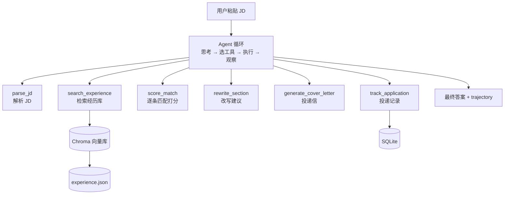

# 求职助手 Agent

> 一句话说明：<待填 —— 写完之后念给一个同学听，他听不懂就重写>

---

## 1. 解决什么问题

正在找 AI 方向实习 / 工作的同学（包括我自己），每天面对大量 JD，要反复做三件低效的事：

1. 逐条对照 JD 要求，判断自己够不够格
2. 反复改简历，但不知道该针对这份 JD 改哪里
3. 投完之后没有记录，不知道投了哪些、进展如何

通用大模型能帮上忙，但它有两个问题：**不会为你逐条核对**（习惯性给一个含糊的正向评价），
**也不会承认你的缺口**（容易顺着你说）。

## 2. 用户是谁

- **第一个用户：我自己** —— 每天投递时真用
- 后续：同样在找 AI 方向实习的同学

> 真实用户的价值不在简历上写"服务了多少人"，而在于：**有人用，你就不敢糊弄，
> 而且能拿到真实的失败案例。**

## 3. 输入 / 输出

| | 内容 |
|---|---|
| **输入** | 一份 JD 原文（粘贴）+ 我的经历库（`data/experience.json`） |
| **输出** | 1. 逐条要求的匹配判定（命中 / 缺口）<br>2. 匹配总分 + 最该补的 3 条缺口<br>3. 针对缺口的简历改写建议（**带改动理由 + 对应 JD 的哪一条**）<br>4. 投递信 / 打招呼话术<br>5. 投递状态写入本地数据库 |

**关键设计**：
- 匹配**必须逐条判定**，不能只给一个总分 —— 这是和"直接问 ChatGPT"的核心区别
- 改写建议**必须留痕**（为什么改、对应哪条要求），并**主动标出夸大风险**

## 4. 评估指标

> ⚠️ **只列指标名和测法，不放数字。** 数字在 Day 12 跑出真实数据后才填进第 8 节。

| 指标 | 怎么测 |
|---|---|
| 检索命中率 | 人工抽检 20 条查询，Top-5 是否含正确经历 |
| 匹配一致率 | 抽 20 条 requirement，人工判断 Agent 的 matched 对不对 |
| 工具成功率 | 从 trajectory 统计报错的 step 占比 |
| 平均步数 / P95 延迟 / 单次成本 | 从 trajectory 直接算 |
| **投递回复率** | 用工具改简历前 vs 后，各投 20 家的回复对比 |

**为什么不测"幻觉率"**：幻觉率需要 ground truth（标准答案），
当前条件下无法可靠测量（谁标的？标注一致性多少？）。所以改用不需要 ground truth 的代理指标。

> 诚实说明这件事本身，比编一个数字有价值。

## 5. 我不做什么

- ❌ 不做多模态（图片 / 语音）
- ❌ 不做模型微调
- ❌ 不做登录、用户系统、复杂前端
- ❌ 不做通用 Agent 平台
- ❌ **不爬 BOSS / 实习僧**（反爬是时间黑洞，且有合规风险）—— JD 由用户粘贴

**为什么写这一节**：把边界定死，精力才能集中在核心链路（Agent 循环 + 评估）上。

## 6. 第一个可验证版本

> 目标：**跑通一条端到端链路，不求好。**

- [ ] 粘贴 1 份真实 JD，能输出结构化的 `JDInfo`
- [ ] 能从经历库里检索出相关经历
- [ ] 能输出逐条要求的匹配判定 + 缺口清单
- [ ] 能对 1 条缺口给出带理由的改写建议
- [ ] 人工判断这 4 步的输出是否合理，把结论写进 `docs/decisions.md`

这一步的结论就是第一条真正的决策记录。

## 7. 架构

> 设计图，Day 9 上线后核对更新。



## 8. 量化结果

> Day 12 跑完评估脚本后填。**在此之前保持空白。**

| 指标 | 基线 | 优化后 |
|---|---|---|
| 检索命中率 | | |
| 匹配一致率 | | |
| 工具成功率 | | |
| P95 延迟 | | |
| 单次成本 | | |
| 投递回复率 | | |

## 9. 已知问题

> 持续更新。**这一节面试最加分** —— 能说出自己项目的不足，比只讲优点可信得多。

- （待填）

## 10. 踩坑记录

> 遇到坑就记一条：现象 → 根因 → 怎么修 → 换种修法会怎样。

- （待填）

## 11. 快速开始

```bash
# 1. 建虚拟环境
python -m venv venv
source venv/Scripts/activate        # Windows Git Bash

# 2. 装依赖
pip install -r requirements.txt

# 3. 配置密钥（复制模板后填入自己的 key）
cp .env.example .env

# 4. 自检
python src/config.py
```

---

## 附：项目状态

- [ ] Day 1-3 核心链路
- [ ] Day 4-6 Agent 循环
- [ ] Day 7-9 部署上线
- [ ] Day 10-12 真实用户 + 评估
- [ ] Day 13-14 深度点（MCP server）
